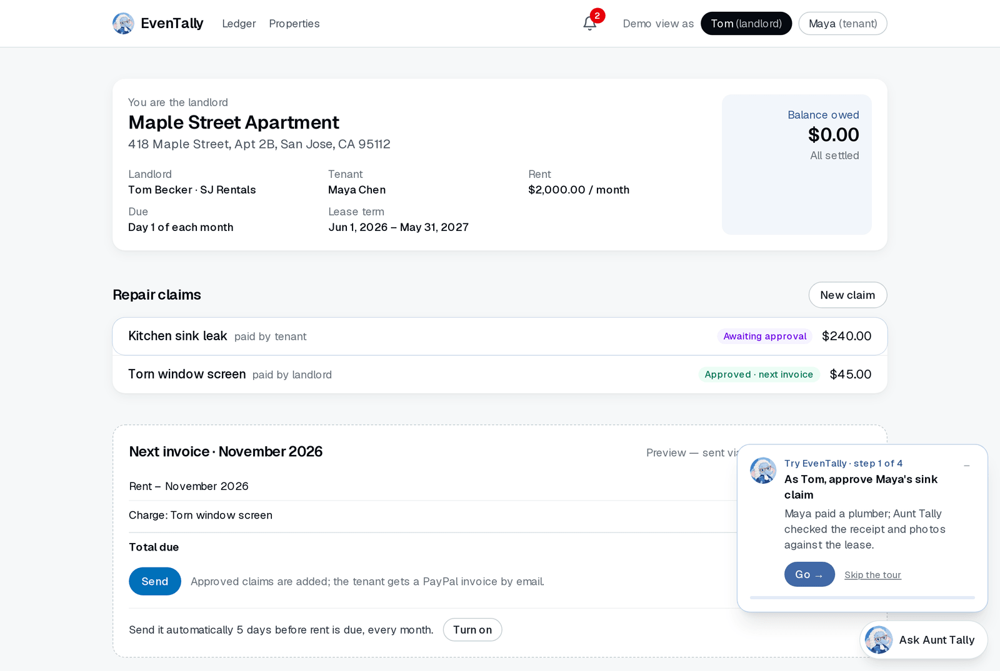
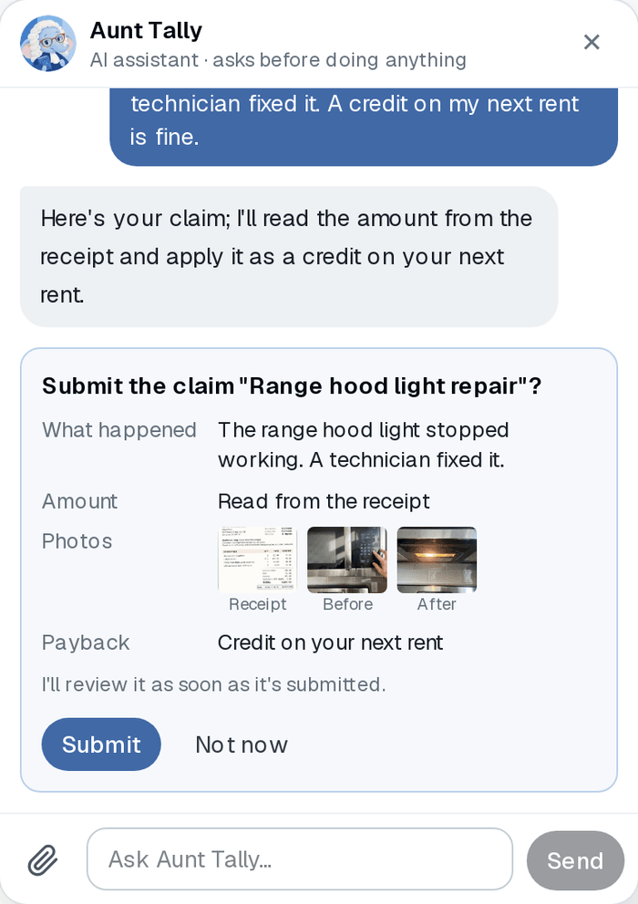
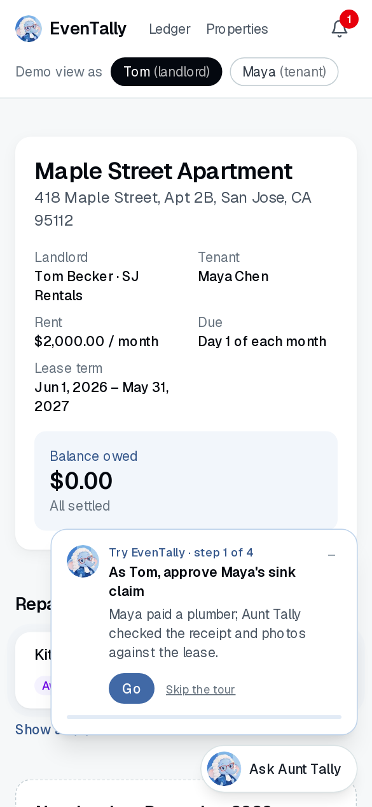
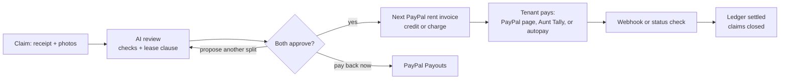

# EvenTally

**Eventually, everyone gets paid back fairly.**

A tenant or landlord fronts a repair and uploads the receipt and photos. Aunt Tally, EvenTally's AI assistant, checks the evidence against the lease and proposes who pays what. Once both sides approve, the amount lands on the next month's PayPal rent invoice as a credit or a charge, or the landlord pays it back right away with PayPal Payouts.

**Live demo:** [even-tally.vercel.app](https://even-tally.vercel.app) · PayPal sandbox, fictional people and data



## The problem

When something breaks in a rental, the tenant often pays for the fix and asks to be paid back later, over text messages. The landlord can't easily check the receipt or the work, the tenant doesn't know when or whether the money comes back, and the lease clause that decides who pays is rarely looked at. Small repairs turn into arguments.

## What it does

- **AI review of every claim.** Aunt Tally reads the receipt, checks that the line items add up and the dates make sense, looks for the same receipt in earlier claims, compares the before and after photos with the work billed, and quotes the lease's repair clause to propose a split. Every step and her reasoning are shown to both sides.
- **Two approvals, then PayPal does the rest.** When landlord and tenant both approve, the split is added to the next PayPal rent invoice as a credit or a charge. The landlord can also pay the tenant back right away with PayPal Payouts.
- **Aunt Tally acts for you, one confirmation at a time.** In chat she explains any month line by line, lists what's waiting on you, files a claim from photos you attach, approves or proposes a split, sends an invoice or a reminder, or pays rent with your saved PayPal. Each action is a card you confirm yourself; she never decides for the other side.
- **Rent on autopilot.** The landlord can have each invoice sent 5 days before rent is due; the tenant can save their PayPal once and turn on autopay for the due date (up to 150% of rent; a bigger invoice waits for them).
- **One shared record.** An activity log both sides see, a notification bell, and a private demo per visitor.

<p>
  
  
</p>

## Try it

1. Open [even-tally.vercel.app](https://even-tally.vercel.app) and pick **Maya** (tenant) or **Tom** (landlord). You get your own copy of the demo; it's deleted after 3 days.
2. Follow **Aunt Tally's tour** in the bottom-right corner. Four steps, about five minutes:
   1. As Tom, approve Maya's sink claim (Aunt Tally already reviewed it).
   2. Send next month's rent invoice through PayPal.
   3. As Maya, pay it: on PayPal's page, or save your PayPal once and let Aunt Tally pay.
   4. File a new claim by chatting with Aunt Tally. Sample photos of a range hood repair are attached for you.
3. The button to press next glows. Switch between Tom and Maya at the top of the page.

**PayPal sandbox buyer** (to pay an invoice on PayPal's page, or to save a PayPal for Maya):

| Email | Password |
| --- | --- |
| `sb-mie9653530690@personal.example.com` | `SANDBOX_PASSWORD_HERE` |

This is a sandbox account: no real money moves.

**Also worth trying**

- **Autopay and auto-send:** turn on "Send it automatically" as Tom and Autopay as Maya, then press **Jump to … and run the schedule**. It runs the real daily schedule for your demo on the next due date.
- **Your own claim:** use **Fill in a sample claim** on the New claim page, or download the [sample photos](https://even-tally.vercel.app/eventally-sample-photos.zip).
- **Ask Aunt Tally** "Explain my latest bill" or "What's waiting on me?".
- **Reset my demo** at the bottom of any page starts over.

## How PayPal is used

| PayPal product | What EvenTally does with it |
| --- | --- |
| [Invoicing API v2](https://developer.paypal.com/docs/api/invoicing/v2/) | Each month's rent invoice. Approved repairs become line items: negative for a credit to the tenant, positive for a charge. Idempotent with `PayPal-Request-Id`. |
| [Webhooks](https://developer.paypal.com/api/rest/webhooks/) | `INVOICING.INVOICE.PAID` settles the ledger and the claims on it; `PAYMENT.PAYOUTS-ITEM.*` tracks payouts. Every delivery is verified with `verify-webhook-signature` on the raw body. |
| [Payouts](https://developer.paypal.com/docs/payouts/) | The landlord pays a tenant back right away instead of crediting rent. |
| [Vault v3](https://developer.paypal.com/docs/checkout/save-payment-methods/) + [Orders v2](https://developer.paypal.com/docs/api/orders/v2/) | The tenant saves their PayPal once. Aunt Tally (on their confirmation) or autopay then creates an order with the vault id, keyed by the invoice so it can't charge twice, and records the payment on the PayPal invoice. |
| [PayPal Agent Toolkit](https://github.com/paypal/agent-toolkit) | Aunt Tally's `get_invoice`, `search_invoicing` and `send_invoice_reminder` tools. |

If a webhook is late or can't reach the app, the ledger also asks PayPal for the invoice's status every few seconds while it waits, so a payment always shows up.

## How the AI works

**The review agent** ([lib/agent/review.ts](lib/agent/review.ts)) is Claude with tools. It decides which checks to run and in what order: `record_receipt`, `check_math`, `check_dates`, `check_duplicate`, `assess_photos`, `estimate_price`, `request_more_evidence` and `propose_split`. The arithmetic, dates, duplicates and price ranges are plain code; the model reads the receipt and photos, interprets the lease, and explains its reasoning.

**Aunt Tally's chat** ([lib/assistant/chat.ts](lib/assistant/chat.ts)) looks things up with read-only tools, and her `prepare_*` tools only return a confirmation card. The action runs when the person presses it, through the same code as the regular pages, which checks permissions again ([lib/assistant/actions.ts](lib/assistant/actions.ts)).

**Guardrails**

- Every dollar amount the AI writes must come from the receipt, the ledger or a tool result; anything else is sent back to be rewritten ([lib/guard.ts](lib/guard.ts)).
- The AI never moves money and never decides for the other side. Splits need both approvals; every chat action needs the person's own press.
- At most three reviews per claim, and one request for more evidence.
- The daily schedule (auto-send, autopay) is plain code that follows settings people switch on themselves. It never calls the AI.

The model is set with `REVIEW_MODEL` and `ASSISTANT_MODEL`; the live demo runs Claude Haiku 5.5 to keep costs low, and the default is Claude Opus 5.5.

## Architecture



- **App:** Next.js 16 (App Router, Server Actions), React 19, Tailwind CSS 4
- **Data:** Neon Postgres with Drizzle ORM; every action is also written to an append-only event log
- **AI:** Anthropic Claude via `@anthropic-ai/sdk`, PayPal Agent Toolkit
- **Hosting:** Vercel, with Vercel Cron for the daily schedule and Vercel Analytics

## Run it locally

You need Node.js 20.9 or newer, a [PayPal developer](https://developer.paypal.com/) sandbox app with a Business and a Personal sandbox account, an [Anthropic API key](https://console.anthropic.com/), and a [Neon](https://neon.tech/) Postgres database.

```bash
npm install
cp .env.example .env      # fill in the values
npm run db:migrate        # create the tables
npm run db:seed           # WIPES the database, then loads the sample photos
npm run dev               # http://localhost:3000
npm test                  # unit tests
```

| Variable | What it's for |
| --- | --- |
| `PAYPAL_CLIENT_ID`, `PAYPAL_CLIENT_SECRET`, `PAYPAL_API_BASE` | Your sandbox app |
| `PAYPAL_SANDBOX_MERCHANT_EMAIL`, `PAYPAL_SANDBOX_BUYER_EMAIL` | The demo landlord and tenant |
| `PAYPAL_WEBHOOK_ID` | The webhook for `<your URL>/api/webhooks/paypal`, subscribed to *Invoice paid* and the *Payouts item* events |
| `ANTHROPIC_API_KEY`, `REVIEW_MODEL`, `ASSISTANT_MODEL` | Claude |
| `DATABASE_URL` | Postgres |
| `CRON_SECRET` | Protects `/api/cron/daily` (Vercel Cron sends it as a bearer token) |

PayPal needs a public URL to deliver webhooks. Without one, payments still settle through the status check.

## Project structure

```
app/                 pages, route handlers and UI components
  (shared)/ledger    the ledger, rent months and history
  (shared)/claims    claims, the review, evidence and approvals
  api/               assistant, webhooks, cron, demo, vault
lib/
  agent/             the review agent and its checks
  assistant/         Aunt Tally's chat, context and actions
  invoicing.ts       rent invoices and settlement
  paypal.ts          the PayPal REST client
  vault.ts           saved PayPal and paying with it
  schedule.ts        auto-send and autopay
  demo.ts            each visitor's private demo
drizzle/             database migrations
demo-assets/         fictional sample receipts and photos
```

## Privacy and safety

- PayPal sandbox only; all people, businesses and receipts are fictional.
- Each visitor's demo is isolated, and deleted after 3 days.
- Secrets live in environment variables and never in the repository.

## What's next

Real sign-in and invites by email, email notifications (the in-app setting is ready for it), changing a lease's term with both sides' consent, settling open claims when a lease ends, and letting the review learn from how earlier claims on the same lease were settled.

## License

[MIT](LICENSE). Built for the [PayPal AI Hackathon](https://paypalaihackathon.devpost.com/).

Built with the help of [Claude Code](https://claude.com/claude-code).
